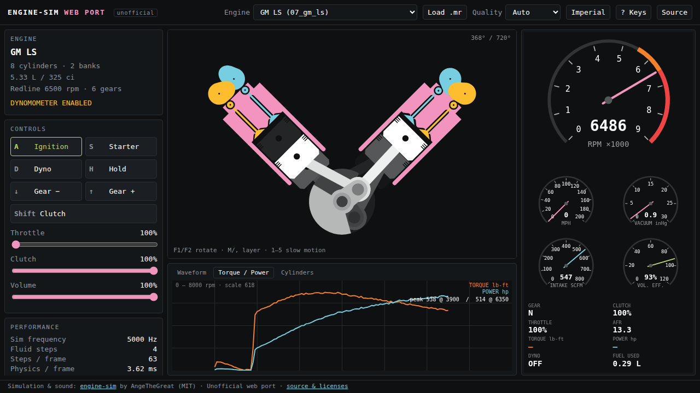

# engine-sim Web Port (unofficial)

**Run [engine-sim](https://github.com/ange-yaghi/engine-sim) in your browser.**
No install, no Windows. It runs on desktop and mobile.

▶ **Live demo: https://kuroron000234.github.io/engine-sim-web/**



> [!IMPORTANT]
> **This is an unofficial port. All credit for the simulator goes to its author.**
> engine-sim was created by **AngeTheGreat (Ange Yaghi)** and is released under the MIT License.
> This port runs his C++ simulation, combustion, gas-dynamics, scripting and audio code, compiled
> to WebAssembly. Nothing in it is a reimplementation. This project is not affiliated with or
> endorsed by the original author.
>
> - Original source: https://github.com/ange-yaghi/engine-sim
> - Official desktop builds (Community Edition): https://github.com/Engine-Simulator/engine-sim-community-edition/releases
> - Project website: https://www.engine-sim.parts/
> - Support the author: https://www.patreon.com/atg_engine_simulator

---

## What this is

engine-sim simulates an internal combustion engine in real time. Pistons, rods and crankshaft
are rigid bodies. Intake, combustion chambers and exhaust are gas systems. The exhaust flow is
turned into sound by convolving it with real impulse responses. The upstream app is
Windows-only (DirectX + DirectSound through the author's Delta Studio engine).

This repository keeps the simulation core untouched and replaces only the platform layer:

| Upstream (desktop) | This port (web) |
|---|---|
| Delta Studio / DirectX renderer with 3D part models | 2D canvas renderer (`web/main.js`) drawing the same parts from the simulator's rigid-body poses |
| DirectSound audio buffer | AudioWorklet (`web/audio-worklet.js`) fed directly from a Web Worker |
| Audio rendering thread + main loop | Single-threaded loop in a Web Worker (`web/sim-worker.js`) |
| Loads `assets/main.mr` from disk | Bundled scripts in a virtual file system; pick an engine or upload your own `.mr` |

### Features

- All 20 engines that ship with engine-sim (single-cylinder ATV up to the Merlin V12, plus
  5- and 9-cylinder radials with master/slave rods).
- Live engine view: pistons, rods, crank throws per layer, valves, cams and combustion flame.
- Gauges: tachometer, speed, manifold vacuum, intake airflow, volumetric efficiency, AFR,
  dyno torque and power, gear and clutch.
- Scope panel: audio waveform, dyno torque/power curve, per-cylinder pressure and temperature.
- Dynamometer sweep and hold, transmission and clutch, starter, ignition, slow motion.
- **Load your own `.mr` engine script** (e.g. from the community engine catalog).
- **Quality setting with Auto mode** so it stays real-time on slow laptops and phones (see below).
- Imperial and metric units, touch controls, responsive layout.

## Controls

The keys match the desktop app.

| Key | Action |
|---|---|
| `A` | Ignition on / off |
| `S` (hold) | Starter motor |
| `Q` / `W` / `E` / `R` (hold) | Throttle 1% / 10% / 20% / 100% |
| `Space` + mouse wheel | Fine throttle (keeps the setting) |
| `↑` / `↓` | Gear up / down (below 1st = neutral) |
| `Shift` (hold) | Disengage clutch |
| `T` / `U` (hold), `Y` | Slip clutch less / more, keep current clutch |
| `D` | Dynamometer on / off (sweeps up to redline) |
| `H`, `G` + wheel | Dyno hold, hold speed |
| `1` – `5` (hold) | Slow motion 1/10 … 1/1000 |
| `Z` `X` `C` `V` `B` + wheel | Volume, convolution, high-freq gain, low-freq noise, high-freq noise |
| `N` + wheel | Simulation frequency |
| `M` / `,` | Render layer deeper / shallower |
| `F1` / `F2` / `F3` | Rotate view / reset |

On touch devices, use the on-screen buttons (ignition, starter, dyno, gears, clutch) and the
throttle / clutch / volume sliders.

**Quick start:** press **Start**, then **A** (ignition), hold **S** until it fires, then press
**R** or drag the throttle slider.

## Performance and quality

The simulator is CPU-heavy. Each frame runs thousands of rigid-body and gas-dynamics steps, and
the audio path convolves every output sample with an impulse response of up to 10,000 samples.
Measured on the same machine, the WebAssembly build is about as fast per step as the native
build.

The **Quality** menu trades fidelity for speed:

| Level | Simulation frequency | Fluid sub-steps | Impulse response |
|---|---|---|---|
| High | engine default (5–20 kHz) | 8 | up to 10,000 samples |
| Medium | 75% | 6 | 6,000 |
| Low | 50% | 4 | 3,000 |
| Very low | 35% | 3 | 1,500 |

**Auto** (the default) measures how long each frame takes compared with the simulated time. It
steps down when the CPU can't keep up and steps back up when there is headroom. If the machine
is still too slow, the simulation runs slower than real time instead of glitching.

Other optimizations in this port:

- **SIMD convolution.** The exhaust convolution keeps a mirrored ring buffer, so the window is
  always contiguous, and uses WebAssembly SIMD (`f32x4`). Audio synthesis used to take 25–40%
  of each frame; it now takes a few percent. The math is the same (Σ h[i]·x[n−i]), only the
  summation order differs.
- LTO + `-O3`. The simulation runs in a worker, so the UI thread only draws.
- Drawing happens only when new data arrives; gauges redraw at half rate, and the low levels
  also reduce canvas resolution.
- Only the impulse responses the scripts reference are bundled (≈0.85 MB instead of 5.4 MB).

## How it works

```
 main thread (main.js)                 Web Worker (sim-worker.js)               AudioWorklet
 ───────────────────────               ──────────────────────────               ────────────
 keyboard / touch ──controls──▶  es_set_throttle(), es_set_gear() …
                                       every ~6 ms: es_frame(dt)
                                         ├ Simulator::startFrame / simulateStep … ×N
                                         ├ Synthesizer::renderAudio  (convolution)
                                         └ readAudioOutput ── int16 chunks ──MessagePort──▶ ring buffer
 canvas renderer ◀──state + poses (60 Hz)──┘                         ◀── samples consumed ──┘   → speakers
```

- The upstream frame loop is kept as is. `startFrame()` sizes the number of physics steps from
  the elapsed time and the synthesizer's input latency (target 100 ms), exactly as the desktop
  app does.
- Audio is paced by the AudioWorklet. It reports how many samples it consumed, and the worker
  only reads as much synthesizer output as it takes to keep about 70 ms queued.
- `.mr` scripts are compiled at runtime by the original Piranha compiler. The `es/` standard
  library, the engines in `assets/engines/` and the impulse responses are packed into
  `engine.data` (Emscripten virtual file system).

### Changes made to the upstream code

The upstream code is **not vendored** in this repository. `native/build.sh` clones
`ange-yaghi/engine-sim` at commit
[`85f7c3b`](https://github.com/ange-yaghi/engine-sim/tree/85f7c3b959a908ed5232ede4f1a4ac7eafe6b630)
with its submodules, and `native/patch_upstream.py` applies these minimal patches:

- MSVC-only constructs → standard C++: backslashes in `#include` paths, `__int64`,
  `__forceinline`, `extern constexpr` → `inline constexpr`, a shadowed template parameter, a
  forward-declared `Matrix`, a nested struct with default member initializers, and a typo
  (`start` → `m_start`) in a template body MSVC never instantiated.
- Piranha: Boost.Filesystem → `std::filesystem`.
- Synthesizer: a non-blocking render path for single-threaded builds (`ESWEB_SINGLE_THREAD`),
  and the Delta Studio include removed.
- Convolution filter: the contiguous / SIMD version described above.

`native/bridge.cpp` replaces `EngineSimApplication`. It loads scripts, ports the input handling
of `processEngineInput()` (throttle smoothing, clutch, dyno sweep and hold), reads the WAV
impulse responses and exposes a small C API to JavaScript.

## Differences from the desktop app

- The engine view is a 2D approximation drawn on canvas. The desktop app uses the author's 3D
  part models, which are not included here.
- The UI layout is new and simpler. Some desktop panels (e.g. the full oscilloscope cluster,
  the firing order display) are replaced by the waveform / dyno / cylinder views.
- No video capture or Discord Rich Presence.
- Some heavy engines can't run at full quality on slower machines (see *Performance*).

## Building

Requirements: [Emscripten](https://emscripten.org/docs/getting_started/downloads.html), `flex`,
`bison`, `python3`, `git`.

```sh
source /path/to/emsdk/emsdk_env.sh
cd native
./build.sh web          # → web/engine.js, web/engine.wasm, web/engine.data
cd ../web
python3 -m http.server 8765
# open http://localhost:8765/
```

`./build.sh native` builds a headless smoke test (needs `clang`). It starts an engine, revs it
and prints rpm and timing, which is handy for checking that the port behaves like the original.

Any static host works. No special headers are needed (no SharedArrayBuffer). The `web/`
folder is deployed to GitHub Pages by `.github/workflows/pages.yml`.

## Repository layout

```
native/
  build.sh              fetch + patch upstream, compile to WebAssembly (or native smoke test)
  patch_upstream.py     portability and performance patches (see above)
  bridge.cpp            C API between the simulator and JavaScript
  compat.h              forced-include shim for MSVC keywords
web/
  index.html, style.css, main.js    UI, renderer, input
  sim-worker.js                     simulation loop, auto quality
  audio-worklet.js                  audio output
  engine.js / engine.wasm / engine.data   build output (committed so Pages can serve it)
docs/screenshot.png
```

## License and credits

- **engine-sim**, **Piranha** and **simple-2d-constraint-solver**: © 2022 Ange Yaghi
  (AngeTheGreat), MIT License. That includes the simulation code, the `.mr` engine scripts and
  the impulse-response recordings bundled in `engine.data`.
- **This port** (bridge, build scripts, patches, web UI): © 2026 kuroron000234, MIT License.
- Third-party license texts (engine-sim, flex, Emscripten, …): see
  [THIRD_PARTY_NOTICES.md](THIRD_PARTY_NOTICES.md). The license for this repository is in
  [LICENSE](LICENSE).

If you enjoy this, please try the real desktop app and support the original author on
[Patreon](https://www.patreon.com/atg_engine_simulator). Join the
[engine-sim Discord](https://discord.gg/chKreEmXw6) for engines and tuning.
